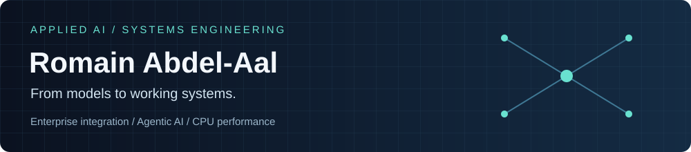

  

<h3 align="center">Senior AI Consultant · AI Solutions Architect · Forward Deployed Engineer</h3>

Paris, France · Consulting · Freelance · International remote

  <a href="https://github.com/bahira?tab=repositories">Projects</a> ·
   ·
  <a href="#03--technical-expertise">Technical expertise</a> ·
  <a href="#05--how-i-can-contribute">Work with me</a>

---

I build AI-enabled software that connects models to real data, APIs and business workflows. My focus is practical delivery: technical discovery, integration, prototyping, evaluation and performance engineering.

## 01 / Featured engineering projects

| Project | What it demonstrates | Explore the evidence |
| --- | --- | --- |
| [VisualTrader](https://github.com/bahira/visualtrader) | Market data ingestion, order-book replay, SQLite persistence, paper trading and execution-cost modeling | [Architecture](https://github.com/bahira/visualtrader/blob/main/docs/ARCHITECTURE.md) · [Microstructure research](https://github.com/bahira/visualtrader/blob/main/docs/MICROSTRUCTURE.md) |
| [SuperSpear](https://github.com/bahira/superspear) | Symbolic regression, reproducible mathematical kernels, C and WebAssembly exports, MCP tooling | [Project page](https://bahira.github.io/superspear/) · [npm package](https://www.npmjs.com/package/spear-kernels) |
| [SPEAR Unified](https://github.com/bahira/spear-unified) | Python research runtime, numerical validation and CPU inference experiments | [Numerical quality gates](https://github.com/bahira/spear-unified/blob/main/reports/NUMERIC-QUALITY-GATES-2026-11-19.md) · [Native CPU experiment](https://github.com/bahira/spear-unified/blob/main/reports/SPEARVM-NATIVE-CPU-EXPERIMENT-2026-11-19.md) |
| [SpearVM](https://github.com/bahira/SpearVM) | Native SIMD kernels, packed CPU inference and Python/C integration | [Use cases](https://github.com/bahira/SpearVM/blob/master/docs/USECASES.md) · [Source and limitations](https://github.com/bahira/SpearVM) |

### Reproduce locally

- **VisualTrader:** Node.js 24; run `npm run demo -- --port 8788` for a synthetic paper-trading demo, or `npm test` for the test suite. No real orders.
- **SPEAR Unified:** Python 3.10+; run `python -m unittest discover -s tests -v` and `python bench.py` from the repository.
- **SuperSpear and SpearVM:** follow their repository-specific installation and validation instructions, including CPU requirements and known packaging limitations.

These are project-documented commands, not a claim that all tests were rerun today. Research results are workload-specific; no universal acceleration or trading profitability is claimed.

## 02 / Additional research

- [FrankenSpear](https://github.com/bahira/frankenspear) — experimental neuro-symbolic architecture combining WASM kernels and small-model routing.
- [Spear-Fable](https://github.com/bahira/spear-fable) — lightweight agent architecture and compact policy experiments.
- [BitCompute](https://github.com/bahira/bitcompute) — peer-to-peer distributed computing experiments.

## 03 / Technical expertise

| Domain | Focus |
| --- | --- |
| Applied AI | LLMs, SLMs, agentic workflows, tool calling, evaluation |
| Enterprise integration | Python, MCP, FastMCP, REST APIs, SQL, cloud integration |
| Software engineering | C, JavaScript, TypeScript, Node.js, React, automation |
| Performance and research | SIMD, WebAssembly, symbolic regression, numerical validation, reproducible benchmarks |
| Financial technology | Market data, order-book replay, quantitative research, simulation |

## 04 / Current engineering focus

- Enterprise AI gateways: tool interfaces, data integration, access control and auditability.
- Multi-agent evaluation: deterministic environments and comparative LLM experiments.
- Native AI assistants: local inference, voice interfaces and desktop integration.

These are ongoing development areas, not claims of production deployment.

## 05 / How I can contribute

- Translate business requirements into working AI prototypes and integration plans.
- Connect LLMs to enterprise APIs, data sources and operational workflows.
- Design evaluation methods, investigate bottlenecks and document engineering trade-offs.
- Collaborate with business and engineering teams from discovery through implementation.

Interested in Senior AI Consultant, AI Solutions Architect, Forward Deployed Engineer and AI Deployment Engineer engagements, including financial-services environments.

**Languages:** French and English.

[Explore my public repositories](https://github.com/bahira?tab=repositories)
